# Salut ! Moi c'est Valentin 👋

### 🚀 PDG chez Groupe FiveHost | Étudiant @ Epitech

Passionné par l'informatique, le développement logiciel, le DevOps et la direction d'entreprise.

---

### 💼 Expériences & Parcours

- 🏢 **PDG chez Groupe FiveHost** : Direction générale, Stratégie d'entreprise, Leadership & Gestion de projet.

- 🎓 **Epitech - L'école de l'excellence informatique** : Formation avancée en informatique et développement logiciel.

---

### 🛠️ Langages & Technologies

#### Langages de programmation

#### Frameworks & Bibliothèques

#### Outils, BDD & DevOps

---

### 🌟 Compétences & Soft Skills

- **Management & Vision** : Leadership, Direction générale, Stratégie d'entreprise, Gestion de projet.

- **Savoir-être** : Travail d'équipe, Responsabilité, Adaptabilité, Dynamisme.

---

### 📊 Statistiques GitHub

  
  &nbsp;
  

---

### 📫 Me retrouver

